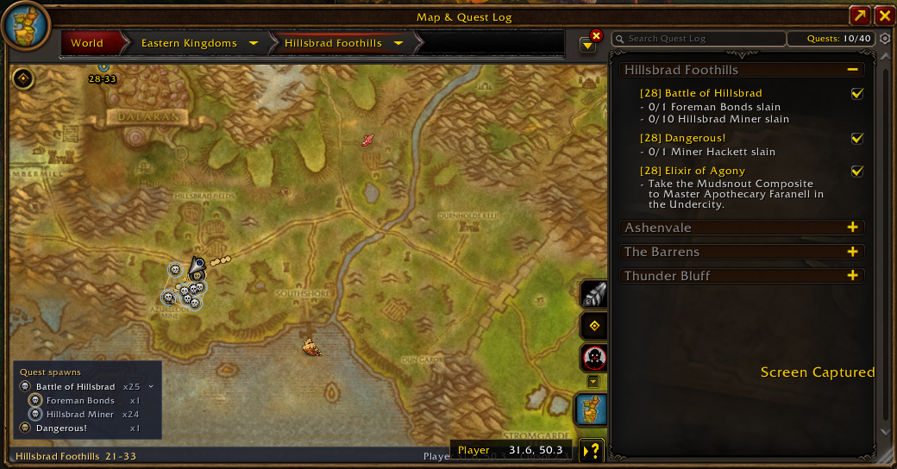
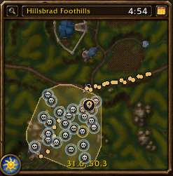

# Polestar: Mob Markers

A companion to [Polestar](https://github.com/fitzforge/polestar): marks every spawn point of the mobs your active quests need on the world map and minimap, in Polestar's own look, its skull on its medallion.

- **One colour per quest**: the skull's colour tells you which quest a mob is for.
- **One ring per mob**: when a quest needs several kinds of mob, a coloured ring around the marker tells them apart.
- **Legend** on the world map lists each quest and how many spawns it has; hover a row to highlight its markers, and expand it to see its mobs.
- **Objects too**: things you pick up or use for a quest (Dry Branches, crates, plants) get the guide's pickup bag instead of the skull, in the same quest colour.
- Hover a marker for the mob, its quest and what it drops.

## Requirements

- [Polestar](https://github.com/fitzforge/polestar): the skull and medallion art comes from it.
- LibForeverData: the spawn data.

## Install

Put the `Polestar_Mob_Markers` folder in `Interface\AddOns`.

## Usage

- **Minimap button**: left-click for the options, right-click to hide or show all markers, drag to move it around the minimap. It is also in the addon compartment.
- `/mobmarkers` or `/pmm`: rebuild the markers and print what was found on the current map.
- `/pmm config`: open the options.
- `/pmm preview`: mark every quest's mobs, not just your quest log's (for testing).

## Options

- Show on the world map and/or the minimap, and the world map legend.
- Only Polestar's current step (on by default): mark just the quests the guide step you're on works on, instead of your whole quest log.
- Colour palettes for quests and for mobs, including a colour-blind safe one.
- Marker sizes for the world map and the minimap.
- Medallion opacity, and skull & ring opacity.
- The minimap button.
